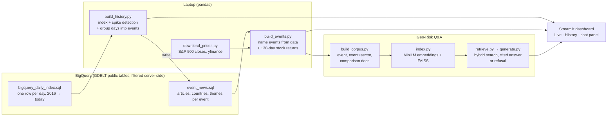

# Geopolitical Risk Monitor

> VIX tells you how scared the market is. This tells you *why*, and what happened last time.

A data pipeline and dashboard that turns 10 years of GDELT global news (2016–2026) into a daily **Geo-Tension Index**, **detects tension spikes and names them automatically**, measures how S&P 500 sectors moved afterwards, and lets you ask questions about the results in plain English through a **cited RAG chat** that refuses when the data has no answer.

No prediction, no hand-labelled events: every spike date, event name and number comes from the data and can be traced back to it.

**Origin.** Started as an NYU Big Data team project (Spring 2026: David Hong, Jonghyun Jeong, Tinos Vafias) on the NYU Dataproc cluster. After cluster access ended, Jonghyun rebuilt the pipeline on BigQuery + pandas, fixed several problems in the original method (see [What changed from the original](#what-changed-from-the-original)), and added the Q&A. The original Spark code is kept in [`legacy/`](legacy/).

---

## Architecture



The BigQuery steps return small CSVs (about 4,000 daily rows, then a few thousand articles per run), so nothing large is downloaded.

---

## Pipeline

### 1. Daily Geo-Tension Index

```
raw   = avg(negative tone) × ln(article_count + 1)
index = raw scaled to 0–10 with the 1st/99th percentiles (for display)
```

- **Articles counted:** GDELT GKG articles whose **Themes** contain a geopolitical category (conflict, sanctions, unrest, diplomacy, ceasefire, espionage/cyber, nuclear/blockade; whole theme tokens, so `WAR` doesn't match `AWARD`), that mention at least one **non-US country** in **Locations**, with a valid tone.
- **Negative tone** is the 3rd value of GDELT's `V2Tone`. Multiplying by log volume captures both how negative and how much the world is talking about it; the log keeps crisis days (10–50× normal volume) from swamping everything else.

### 2. Spike detection

1. A **spike day** is a day whose **raw** score is more than **3 standard deviations above that year's mean**. Per year, because news volume changes over time. The raw score is used rather than the 0–10 index, because the index is capped at 10 and a threshold on it can land above 10 and never fire.
2. Spike days at most 3 days apart are grouped into one **event**, dated by its peak day.

On data through 2026-11-17: **45 spike days → 27 events** over 3,956 days, with events in every year from 2016 to 2026.

### 3. Naming events from the data (no LLM, no hand labels)

For each event, BigQuery counts the countries, categories and GDELT themes in its articles from peak −1 to +1 day. Raw counts don't work: the UK, Russia and military themes appear around almost every event. So each item gets a **lift** score:

```
share = fraction of this event's articles that mention the item
lift  = share / the item's average share across all events
```

The name is the 1–2 most distinctive countries (mentioned at least 1.5× their usual share, ranked by share × log(1 + lift)) plus the most over-represented category that covers at least 25% of the event's articles (otherwise "conflict"), e.g. `Sri Lanka: unrest` (2019-04-21) or `Belgium: terror attack` (2016-03-22). It is the same idea as TF-IDF, applied to GDELT's country and theme tags, so it is deterministic and explainable. The most distinctive themes (e.g. `TAX_RELIGION_CHURCH` for 2019-04-21) are stored next to the name as evidence.

### 4. Market reactions

For every event and every S&P 500 member (today's constituents via yfinance; companies that left the index are missing, so there is survivorship bias), the return from the **first trading day on/after the peak** to each day within ±30 calendar days. The dashboard and Q&A average these over 6 sector groups (`dashboard/constants.py`).

---

## Dashboard

`streamlit run dashboard/app.py`

- **Live:** today's tension in σ and as a past-year percentile ("higher than X% of days"), the risk level (z-score of the latest day vs this year, same rule as spike detection), latest geopolitical headlines from GDELT's 15-minute feed, live sector ETF moves, and the historical average reaction of a sample portfolio.
- **History:** 10 years of daily tension in standard deviations from each year's average (the same number spike detection uses, so every event sits above the +3σ line), plus a table of all events; an event explorer with the index and VIX around the event, sector returns at Day +5, and the event's news.
- **Ask the data:** a chat panel on the right (open/close it with the button at the top; the main view widens when it's closed).

---

## Geo-Risk Q&A (RAG)

Ask *"Which sector fell most 5 days after the spike on 2019-04-21?"* and get a short answer with numbered citations (event date and news source) plus the documents it used. If the data doesn't contain the answer, it says **"I don't have evidence for that in the data."** It never gives investment advice.

**RAG in one line:** first *retrieve* the few pieces of our own data that match the question, then have an LLM *write* the answer using only those pieces.

### Design

| Choice | What | Why |
|---|---|---|
| Documents | 1 per event (index, z-score, window, countries, themes, headlines, sector ranking) + 1 per event × sector (Day +1/+5/+30 returns) + 7 comparison summaries (per sector across all events, and all events by z-score) | Matches the questions people ask: "what happened on X?", "how did sector Y react?", "after which event did Y fall most?" Event and sector docs stay under the embedding model's 256-token limit. |
| Embeddings | `sentence-transformers/all-MiniLM-L6-v2`, FAISS exact cosine search | Small, free, runs on a laptop CPU; a corpus of ~200 short docs doesn't need approximate search. |
| Hybrid retrieval | Embedding rank + BM25 keyword rank, merged with Reciprocal Rank Fusion `1/(60+rank)` | Added when embeddings alone missed questions that name a date (on the earlier 31-event data, hit@5 went from 56.5% to 87.0%). RRF only uses ranks, so the two scores don't need calibrating. With date-aware retrieval now in place, BM25 adds little on the current eval (see Results); `GEO_QA_RETRIEVER=dense` turns it off. |
| Date-aware retrieval | If the question names an event date, that date's documents rank first, and the event document is always included | Each date has 7 near-identical documents; without this, six sector docs could push out the event doc that holds the index and the full sector ranking. |
| Filters | Date range and sector in the UI, applied after scoring | A filter can never hide a better match. |
| LLM | Gemini (default, free tier) or Claude, chosen with `GEO_QA_PROVIDER`; key from an environment variable | Same prompt and checks with either provider. |
| Refusal | Similarity gate before the LLM (no call if nothing relevant), plus a prompt rule | The model can't make something up from irrelevant documents. |
| Citations | The model cites document IDs (`[event:2019-04-21]`); code checks each was actually retrieved and shows it as a numbered source | Short IDs are easy to copy exactly and to verify. |

Prompt (abridged; full text in `rag/generate.py`):

```text
Use ONLY the facts in the <documents>. No outside knowledge, no guessed numbers.
Cite the document id in [brackets] after every factual sentence.
If the documents don't contain the answer, reply exactly:
  "I don't have evidence for that in the data."
Never give investment advice; if asked, start with "I can't give investment advice."
```

### Evaluation

`rag/eval/make_questions.py` generates the questions **from the data**, so expected answers are computed, not typed: weakest sector at Day +5 on a date, a sector's Day +30 move, the index on a date, the most-mentioned country, questions that name only the event, and questions that compare all events (only when the answer is unique). Plus 5 questions the data can't answer (advice, prediction, Bitcoin, 2008, the Fed).

`rag/eval/run_eval.py` reports:

- **Retrieval hit rate @k:** an expected document is in the top k.
- **Answer accuracy:** the answer contains the expected sector, country, date or number.
- **Groundedness:** every cited ID was retrieved, and every number and date in the answer appears in the retrieved documents.
- **Refusal accuracy** on unanswerable questions, and **false refusals** on answerable ones.

### Results

Run on 2026-11-18 on data through 2026-11-17 (27 events): 29 generated questions (24 answerable, 5 unanswerable), k = 5, `all-MiniLM-L6-v2`, LLM `gemini-3.5-flash-lite` (free tier). Numbers are copied from `rag/eval/results.md`, not edited.

| Metric | First run on the 27 events | Final |
|---|---|---|
| Retrieval hit rate @1 | 15/24 (62.5%) | 20/24 (83.3%) |
| Retrieval hit rate @3 | 18/24 (75.0%) | 23/24 (95.8%) |
| Retrieval hit rate @5 | 18/24 (75.0%) | 24/24 (100.0%) |
| Answer accuracy (answerable) | 18/24 (75.0%) | 24/24 (100.0%) |
| Grounded answers (every number/date found in retrieved docs) | 17/17 (100.0%) | 24/24 (100.0%) |
| Answers citing a document that wasn't retrieved | 0/20 (0.0%) | 0/24 (0.0%) |
| Refusal accuracy (unanswerable) | 5/5 (100.0%) | 5/5 (100.0%) |
| False refusals (answerable) | 4/24 (16.7%) | 0/24 (0.0%) |

**What changed between the two runs, and why.** The first run's 6 misses were all retrieval misses. Five were "index on <date>" / "weakest sector on <date>" questions where the six sector documents for that date filled the top 5 and pushed out the event document; in one of them the model then answered from an incomplete set of sectors and got it wrong. The sixth needed comparing all 27 events, which top-k retrieval can't do. The fixes were date-aware retrieval (that date's documents first, event document always included) and the precomputed comparison documents. The three "most-mentioned country" questions were also rephrased to ask by date: event names are built from those countries, so asking by name gave the answer away.

**Embeddings only vs hybrid** (`run_eval --retriever dense --retrieval-only`, same 24 questions): dense-only hit@1/@3/@5 = 18/24, 24/24, 24/24; hybrid = 19/24, 23/24, 24/24 (measured before the final event-naming change; the final hybrid run is 20/24, 23/24, 24/24). Once date-aware retrieval was added, BM25 no longer makes a clear difference on this set; it is kept because it was what fixed date questions before, and it costs nothing at this corpus size.

**Read with care.** These fixes were made after looking at the failures, on the same kind of generated questions, so the final numbers are optimistic: they show the known failure modes are fixed, not how the system does on new kinds of questions. The set is small (24 answerable), and 100% on it does not mean the system is never wrong.

### Limitations

- **Small eval set** (24 answerable questions): one question moves a rate by about 4 points.
- **"Grounded" is narrow:** it checks that numbers and dates come from the retrieved documents, not that the right document was used.
- **Countries that are in almost all coverage rarely make the name.** The US appears in most international news, so even in the 2026 US–Israel war with Iran (2026-03-01) it isn't 1.5× above its usual share and the event is named "Iran & Israel". Each event therefore also lists the countries in the most articles by plain count. The 1.5× and 25% thresholds were chosen after looking at the names, not tuned on a held-out set.
- **Event names are coarse:** "country: category", not "Christchurch mosque shootings". Some categories are off (the Christchurch and Sri Lanka attacks come out as "unrest"), and two events can share a name; the date tells them apart.
- **Headlines come from article URLs**, not full text.
- **Correlation, not causation:** sector returns are averages that include all other market news in the window.
- **The LLM can still be wrong.** The UI shows the retrieved documents so every answer can be checked.
- **Not investment advice.** See [MODEL_CARD.md](MODEL_CARD.md).

---

## What changed from the original

| Original (course project) | Now |
|---|---|
| 31 spike dates and names **picked by hand** | Detected and named from the data (27 events) |
| Keywords matched against GKG column 7, which is **V2Counts, not Themes**, so every day's category was the same | Themes matched as whole tokens; "international" decided from Locations |
| Spikes detected on the **capped** 0–10 index; in 2017–2020 the threshold was above 10 (10.13, 10.25, 11.88, 10.69), so those years could have **no spikes** | Detected on the uncapped raw score |
| Consecutive spike days counted as separate events | Grouped into one event dated by its peak |
| Weekend spike: no day-0 close, so the dashboard **borrowed another spike's numbers** | Base = first trading day on/after the peak |
| Needed the 2 TB archive on a cluster | Two BigQuery queries (free tier) + pandas on a laptop |

---

## Repository

```
data_collection/
  bigquery_daily_index.sql   step 1: daily inputs (BigQuery)
  download_prices.py         S&P 500 daily closes (yfinance)
  build_history.py           step 2: index, spike detection, events; writes event_news.sql
  bigquery_event_news.sql    template for step 3 (filled in by build_history.py)
  build_events.py            step 4: name events, news, stock reactions
  common.py                  shared helpers
dashboard/
  app.py, collect_live.py    Streamlit dashboard and live GDELT feed
  constants.py               sector groups, country codes
rag/
  build_corpus.py, index.py, retrieve.py, generate.py, ui.py, qa_app.py
  eval/                      question generator, eval script, results
legacy/                      original Spark pipeline (reference only)
MODEL_CARD.md
```

---

## How to run

```bash
pip install -r requirements.txt
```

**Data** (everything lands in `~/dashboard_data_rebuilt/`; set `GEO_DATA_DIR` to use another folder). For the BigQuery steps use a project without billing and check the "This query will process N GB" estimate before running (free tier: 1 TB/month).

1. Run `data_collection/bigquery_daily_index.sql` in the BigQuery console; save the result as `gdelt_daily.csv`.
2. `python -m data_collection.download_prices`
3. `python -m data_collection.build_history` (writes `events.csv` and `event_news.sql`)
4. Run `event_news.sql` in BigQuery; save the result as `event_news.csv`.
5. `python -m data_collection.build_events`

**Q&A and dashboard**

```bash
python -m rag.build_corpus            # -> rag/data/corpus.jsonl
python -m rag.index                   # embeddings + FAISS (downloads the model the first time)
export GEMINI_API_KEY=...             # free key from aistudio.google.com; never commit it
python -m rag.eval.make_questions
python -m rag.eval.run_eval --retrieval-only   # no API calls
python -m rag.eval.run_eval                    # full eval; re-run to resume after a quota stop
streamlit run dashboard/app.py        # run from the repo root (applies the light theme)
```

Optional environment variables: `GEO_QA_PROVIDER` (`gemini`/`anthropic`), `GEO_QA_MODEL`, `GEO_QA_TOP_K` (default 5), `GEO_QA_MIN_SIM` (refusal threshold, default 0.30), `GEO_QA_RETRIEVER` (`hybrid`/`dense`).
