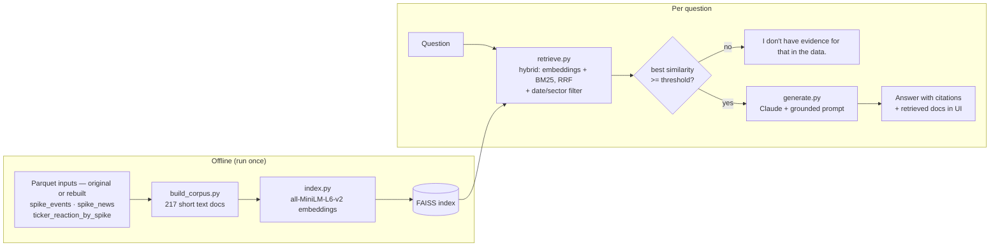

# Geopolitical Event-Driven Portfolio Risk Analysis Platform

> "VIX tells you how scared the market is. This tells you *why* — and what happened last time."

A big data platform that processes 10 years of GDELT global news data alongside S&P 500 price data to detect geopolitical tension spikes, analyze their historical market impact, and visualize the results in an interactive dashboard.

**Team:** David Hong · Jonghyun Jeong · Tinos Vafias — NYU Big Data (Spring 2026)  
**Cluster:** NYU Dataproc (Google Cloud, YARN)  
**Dashboard:** Streamlit + Plotly

---

## Overview

When geopolitical crises happen — wars, sanctions, coups, protests — markets react. But how? Which sectors go up? Which collapse? How fast does it normalize?

This platform answers those questions by:

1. Building a **Geo-Tension Index** from 10 years of GDELT news (2016–2026)
2. Detecting **31 international tension spikes** using statistical anomaly detection
3. Computing **sector-level stock reactions** for each spike event (±30 trading days)
4. Displaying everything in a **Streamlit dashboard** with historical event explorer

No prediction. Pure large-scale data engineering — fully explainable outputs. A small RAG layer (Geo-Risk Q&A) lets users ask questions about these outputs in plain English, with every answer cited back to the data.

---

## Team

| Name | NetID |
|------|-------|
| David Hong | sh8348 |
| Jonghyun Jeong | jj4335 |
| Tinos Vafias | cv2134 |

---

## Architecture

```
GDELT Archive (2016–2026)          S&P 500 Price Data (yfinance)
        |                                       |
        v                                       v
  Download + Filter                     Chunk collection
  (simultaneous, xargs -P 4)            (Parquet format)
        |                                       |
        +-------------------+-------------------+
                            |
                            v
              HDFS: /user/jj4335_nyu_edu/gdelt_project/
                            |
                            v
                   PySpark ETL Pipeline
                   - Daily Geo-Tension Index
                   - Tension spike detection
                   - ±30-day event window aggregation
                   - Spike news extraction
                            |
              +-------------+-------------+
              |                           |
              v                           v
     Reaction Pattern Dataset       Spike News Archive
       (Parquet, per spike)          (TSV, per spike ±3d)
              |                           |
              +-------------+-------------+
                            |
                            v
                  Streamlit Dashboard
                  (Historical Event Explorer + Live Feed)
```

---

## Repository Structure

```
gdelt-risk-platform/
├── data_collection/
│   ├── gdelt_download.sh          # Downloads & filters GDELT GKG (2016–2026)
│   └── rebuild_for_rag.py         # Rebuilds Q&A inputs for the 31 spikes on a laptop
├── pyspark_pipeline/
│   ├── geo_tension_index.py       # Builds daily Geo-Tension Index
│   ├── event_window.py            # Computes ticker reactions ±30d per spike
│   ├── risk_engine.py             # Aggregates sector-level risk scores
│   └── spike_news_extract.py      # Extracts news URLs per spike event
├── dashboard/
│   ├── app.py                     # Streamlit dashboard (3 tabs)
│   └── constants.py               # Sector map + spike labels (shared with rag/)
├── rag/                           # Geo-Risk Q&A (RAG) — see section below
│   ├── build_corpus.py            # Parquet outputs -> text documents
│   ├── index.py                   # Embeddings + FAISS index
│   ├── retrieve.py                # Top-k search with date/sector filters
│   ├── generate.py                # Grounded answer from Claude
│   ├── ui.py / qa_app.py          # Streamlit Q&A (tab or standalone)
│   └── eval/                      # Eval questions + eval script
├── MODEL_CARD.md                  # Intended use, limits, eval results
└── requirements.txt
```
---

## Geo-Tension Index

### Formula
geo_tension_raw = avg(negative_tone) × log(article_count + 1)

### Why this formula?

**`avg(negative_tone)`** — GDELT's V2Tone column provides comma-separated sentiment scores computed automatically from article full text. The third value is the negative score (range: 0–50). We use the daily average across all filtered articles.

Using raw sentiment alone has a flaw: a single highly negative article would score the same as a hundred moderately negative ones. Volume matters.

**`log(article_count + 1)`** — We weight sentiment by article volume to capture the "how much the world is talking about this" dimension. Log scale is used instead of linear because:
- News volume during major crises can spike 10x–50x above normal
- Linear scaling would make crisis days dominate the index and compress all other variation
- Log dampens explosive growth while still rewarding higher volume

**Multiplying the two** captures both *intensity* (how negative) and *scale* (how many articles). A ceasefire with many positive articles scores low. An invasion with massive negative coverage scores high.

**International filter** — Only articles referencing non-US country codes (e.g. `#RS#` for Russia, `#UP#` for Ukraine) are included. This removes US domestic news that would otherwise dominate the index and distort geopolitical signals.

**Normalization** — Final scores are scaled to 0–10 using p1–p99 percentile normalization, making the index interpretable across different time periods without being distorted by extreme outliers.

---

## Spike Detection

### Method
spike = geo_tension_index > yearly_mean + 3 × yearly_std

This is a Z-score based statistical anomaly detection approach. The threshold is computed **per year** to account for the fact that global news volume and sentiment vary across different periods (e.g. COVID era vs pre-2020). A 3σ threshold captures statistically extreme days — roughly the top 0.1% of tension scores — ensuring only genuine geopolitical shocks are flagged, not routine news cycles.

### Labeling

Spike dates falling within known geopolitical events are manually labeled (e.g. "Russia-Ukraine War", "Israel-Hamas War"). For remaining dates, labels are auto-generated from the most frequent keywords in GDELT article titles within ±3 days of the spike.

---

## Data Pipeline

### Phase 1 — Historical Batch (PySpark on NYU Dataproc)

```bash
# 1. Download & filter GDELT
bash data_collection/gdelt_download.sh 2016 2026

# 2. Build Geo-Tension Index
spark-submit --deploy-mode client pyspark_pipeline/geo_tension_index.py

# 3. Detect spikes & compute ticker reactions
spark-submit --deploy-mode client pyspark_pipeline/event_window.py

# 4. Extract supporting news per spike
spark-submit --deploy-mode client pyspark_pipeline/spike_news_extract.py
```

### Phase 2 — Live Feed (in dashboard)

`app.py` polls `gdeltproject.org/gdeltv2/lastupdate.txt` every 15 minutes to fetch the latest GDELT GKG file and display current geopolitical headlines. Sector ETF returns are fetched via yfinance every 1 minute. This matches GDELT's own update frequency.

---

## Why PySpark?

| Task | Why Spark? |
|------|-----------|
| Filter keywords from billions of records | Single machine cannot load the full GDELT archive (2TB+) |
| 500 tickers × 31 spikes × ±30-day windows | Distributed join across partitioned datasets |
| Sector-level aggregations across 500 tickers | Parallel groupBy + window operations |
| Daily tension index from 7.6M articles | Distributed aggregation at scale |

We initially planned real-time Kafka streaming, but GDELT and yfinance rate limits made sub-15-minute updates infeasible. We switched to 15-minute batch collection, which matches GDELT's own update frequency.

---

## Infrastructure

| Component | Tool |
|-----------|------|
| Cluster | NYU Dataproc (Google Cloud Dataproc) |
| Resource Manager | YARN |
| Distributed Processing | Apache Spark (PySpark) |
| Storage | HDFS + Parquet |
| Dashboard | Streamlit + Plotly |
| Live News Feed | GDELT GKG lastupdate.txt polling (15 min) |
| Live Sector Returns | yfinance ETF data (1 min cache) |
| Version Control | Git / GitHub |

---

## Data Sources

| Source | Description | Cost |
|--------|-------------|------|
| [GDELT Project](https://gdeltproject.org) | Global news events, sentiment (2016–present) | Free |
| [yfinance](https://github.com/ranaroussi/yfinance) | S&P 500 daily prices + live ETF data | Free |

---

## GDELT Data Schema

Raw GDELT GKG has 60+ columns. We extract and store only 7:

| Column | Description |
|--------|-------------|
| `record_id` | Unique article identifier |
| `date` | Publication date (yyyyMMddHHmmss) |
| `source` | News outlet |
| `url` | Article URL |
| `themes` | GDELT auto-assigned theme tags including country codes (e.g. `#RS#`, `#UP#`) |
| `tone` | Comma-separated sentiment scores: overall, positive, **negative**, polarity, ... |
| `category` | Geopolitical event category |

We use `themes` for international filtering and the 3rd value of `tone` (negative score) for the Geo-Tension Index.

---

## Data Collection Strategy

We tested four approaches for 1 month of GDELT data (January 2016):

| Method | Time | Size |
|--------|------|------|
| Download only | 15 min | 26 GB |
| Download then filter (sequential) | 44 min | 58 MB |
| Filter only (pre-downloaded) | 29 min | 58 MB |
| **Download + filter simultaneously** ✅ | **5 min** | **58 MB** |

**Final strategy:** Stream directly from GDELT → filter geopolitical keywords on-the-fly → write to HDFS. No intermediate 26 GB storage required.

Geopolitical keywords: `MILITARY`, `SANCTION`, `TERROR`, `CONFLICT`, `WAR`, `PROTEST`, `WEAPON`, `NUCLEAR`

---

## Data Specs

| Dataset | Size | Rows | Period |
|---------|------|------|--------|
| GDELT Raw (original) | ~2TB | ~billions | 2016–2026 |
| GDELT Filtered (geopolitical) | ~5GB | 7.6M | 2016–2026 |
| Geo-Tension Index | ~1MB | 3,744 | 2016–2026 |
| Spike Events | <1MB | 31 | 2016–2026 |
| Ticker Reactions | ~50MB | 878K | per spike |
| Spike News Archive | ~5MB | 6,200 | per spike ±3d |

---

## Dashboard Features

### Tab 1: Live Dashboard

- **4 metric cards**: Current Geo-Tension score, Risk Level (Low/Medium/High), Events Today, Historical Avg Portfolio Change
- **Live chart**: Geo-Tension Index (today vs. last 5 days, 15-min granularity)
- **Latest news**: Real-time geopolitical headlines from GDELT (updates every 15 min)
- **Sector Reaction**: Live ETF returns — JETS, SOXX, XLE, ITA, XLK, GLD (1-min cache refresh). Shows last trading day when market is closed.

### Tab 2: Historical Events

- **10-year chart**: Full Geo-Tension Index (2016–2026) with VIX overlay and spike markers
- **Event Explorer**: Selectbox to choose any of 31 spike events
  - Geo-Tension & VIX chart (±5 days around spike)
  - Sector Impact bar chart (Day +5 returns)
  - Supporting News from GDELT archive (keyword-filtered by event)

---

## VIX vs Geo-Tension Index

VIX and the Geo-Tension Index often move together during major geopolitical events, but not always. VIX reflects all market risk — interest rates, earnings, liquidity, credit — while the Geo-Tension Index is purely news-sentiment based. During major geopolitical shocks (e.g. Russia-Ukraine War, Israel-Hamas War), both tend to spike simultaneously because geopolitical risk dominates market sentiment. During routine market volatility (e.g. Fed decisions), VIX moves while Geo-Tension stays flat.

---

## Challenges & Solutions

| Challenge | Solution |
|-----------|----------|
| 2TB+ raw GDELT data | Keyword filter during download → 5GB |
| US domestic event noise | Filter to articles with non-US country codes only |
| Noisy URL-based titles | Multi-layer regex filter: remove hex strings, URLs, short tokens |
| GDELT/yfinance rate limits | Pre-computed parquet + 15-min batch collection |
| Weekend trading gaps | Nearest trading day fallback |
| Spark datetime bug | Date range filter + CORRECTED rebase mode |
| Irrelevant news in spike explorer | Proper noun keyword filter + conflict context filter |

---

## Setup & Reproduction

### Prerequisites

- NYU Dataproc cluster access
- Python 3.11, PySpark 3.5
- HDFS write access

### Install Dependencies

```bash
pip install -r requirements.txt
```

### Run Dashboard

```bash
streamlit run dashboard/app.py --server.port 8501 --theme.base light
```

### Expose via ngrok

```bash
~/ngrok http 8501
```

---

## Geo-Risk Q&A (RAG)

A **Q&A** tab where you can ask things like *"Which sector fell most 5 days after the Russia-Ukraine War spike?"* and get a short answer that cites the event date and a source article URL, with the documents it used shown underneath.

**RAG (Retrieval-Augmented Generation) in one line:** first *retrieve* the few pieces of our own data that match the question, then ask an LLM to *generate* an answer using only those pieces. The LLM writes the sentence; the facts come from our pipeline outputs.

### Data provenance (read this first)

The original pipeline outputs lived on the NYU Dataproc cluster, and access ended with the course. The Q&A therefore runs on **rebuilt** inputs made by `data_collection/rebuild_for_rag.py` for the same 31 spike dates the original pipeline detected (kept in `dashboard/constants.py`):

| | Original cluster outputs | Rebuilt for the Q&A |
|---|---|---|
| Spike dates & labels | 31, detected by `geo_tension_index.py` | Same 31 dates and labels |
| Geo-Tension Index on the spike day | Yes | **Recomputed** from every GKG file that day with the original formula and the p1/p99 constants kept in `collect_live.py` |
| z-score, yearly threshold | Yes | **No** (need 10 years of daily values) |
| News around each spike (±3 days) | All GDELT GKG files, top 50 per spike | All GKG files for the 161 needed days (same keyword filter), up to 300 per spike |
| Sector returns, Day −30…+30 | All S&P 500 members (yfinance) | The ~50 stocks in the 6 sector groups (yfinance, adjusted closes), same return formula |
| Weekend/holiday spikes | Borrowed the nearest other spike's numbers | Measured from the next trading day's close |

Only the 161 days around the spikes are downloaded, so this runs on a laptop: data is filtered while it streams and only matching rows are saved (a few hundred MB), though the download itself is large (roughly tens to a hundred-plus GB, a few hours depending on connection). `--files-per-day 4` makes a quick sample instead; then no index is recomputed. `build_corpus.py` handles all three shapes (original, full rebuild, sample) and only writes the facts that exist.

### Architecture



### Design choices

| Choice | What we did | Why |
|---|---|---|
| Embedding model | `sentence-transformers/all-MiniLM-L6-v2` (384-dim) | Small (~80 MB), runs on a laptop CPU, free, strong at short English sentence similarity. Our documents are short and factual, so a larger model isn't needed. |
| Chunking | 1 document per spike event + 1 per event × sector (31 + 186 = 217) | Matches the two kinds of questions people ask ("what happened on X?" / "how did sector Y react?"). Each document stays under the model's 256-token limit; `index.py` warns if one doesn't. |
| Vector store | FAISS `IndexFlatIP` (exact search) on normalised vectors | Inner product of unit vectors = cosine similarity. With 217 documents exact search is instant; approximate indexes would only add complexity. |
| Hybrid retrieval | Embedding ranking + BM25 keyword ranking, merged with Reciprocal Rank Fusion: `1/(60+rank_dense) + 1/(60+rank_bm25)` | The first eval run showed embeddings miss exact tokens: 9 of the 10 retrieval misses were questions that name a date (e.g. "the spike on 2024-05-02"). BM25 scores rare exact tokens (a date, a sector name) highly. RRF only uses ranks, so the two score scales don't need calibrating. `GEO_QA_RETRIEVER=dense` turns it off for comparison. |
| Filters | Date range and sector, applied to metadata after scoring all documents | Scoring everything first means a filter can never hide a good match. |
| LLM | Claude via the Anthropic API (`GEO_QA_MODEL`, key from `ANTHROPIC_API_KEY`) | Never hard-coded. The current API has no temperature setting, so answers can vary slightly between runs; eval numbers are from a single run. |
| Refusal | Two layers: similarity gate before the LLM, then a prompt rule | If nothing relevant is retrieved the LLM is never called, so it can't make something up. |
| Citations | Model cites document IDs (`[event:2022-02-25]`); code checks each ID was retrieved, then shows it as `[date · URL]` | Short IDs are easy for the model to copy exactly and easy for code to verify. |

### Prompt template (abridged — full text in `rag/generate.py`)

```text
System:
  Use ONLY the facts in the <documents>. No outside knowledge, no guessed numbers.
  After every factual sentence, cite the document id in [brackets].
  If the documents don't contain the answer, reply exactly:
    "I don't have evidence for that in the data."
  Never give investment advice; if asked, start with "I can't give investment advice."
  "Day +N" = N calendar days after the spike. Headlines come from article URLs.
User:
  <documents>
    <document id="event:2022-02-25" event_date="2022-02-25"> ... </document>
    ...
  </documents>
  Question: ...
```

### Evaluation method

`rag/eval/make_questions.py` builds the eval set **from the data** (expected answers are computed from the corpus, not typed by hand). On the full rebuild it makes 24 answerable questions: weakest sector at Day +5, one sector's Day +30 move, the index value on a date, the most-mentioned country, questions that name only the event (no date), and 2 that need comparing many events (highest index overall and within one year). It adds 5 questions the data can't answer (advice, prediction, Bitcoin, 2008, the Fed), for 29 total. If a fact isn't in the data (e.g. no index in a sample run), questions about it are swapped for other data-derived ones.

`rag/eval/run_eval.py --retriever dense|hybrid` reports (run both to compare retrieval):

- **Retrieval hit rate @k** — did an expected document appear in the top k (k = 1, 3, 5)?
- **Answer accuracy** — does the answer contain the expected sector / country / date / number?
- **Groundedness** — every cited ID must be a retrieved document, and every number and date in the answer must appear in the retrieved documents. Answers with no numbers or dates are listed in `results.md` for manual review.
- **Refusal accuracy** — on unanswerable questions, did it refuse (or decline advice)? It also reports **false refusals** on answerable questions.

### Results

> **Not run yet.** Run the steps below and paste the table from `rag/eval/results.md` here. Do not edit the numbers by hand.

| Metric | Result |
|---|---|
| Retrieval hit rate @1 / @3 / @5 | — |
| Answer accuracy (answerable) | — |
| Grounded answers (auto-checkable) | — |
| Refusal accuracy (unanswerable) | — |
| False refusals (answerable) | — |

### Known limitations

- **Rebuilt data:** index values are recomputed for spike days only (no z-scores or thresholds), and may differ slightly from the originals because the p1/p99 constants are rounded.
- **Small corpus:** 31 events and 6 hand-picked sector groups (~50 S&P 500 stocks), so many reasonable questions have no answer here.
- **Headline text only:** "headlines" are rebuilt from article URLs, not full article text, so the system knows *what* was in the news only roughly.
- **Day +N is calendar days:** when Day +N falls on a weekend or holiday, the nearest trading day is used and written in the document.
- **Comparison questions are hard:** "Which spike was the biggest?" needs all 31 events, but the LLM only sees the top k.
- **The LLM can still be wrong:** citations and automatic checks reduce this but don't eliminate it. Always check the retrieved documents shown under the answer.
- **Not investment advice.** Historical correlations only; see `MODEL_CARD.md`.

### How to run

```bash
pip install -r requirements.txt

# 0. Rebuild the inputs (laptop; resumable — re-run the same command if interrupted)
python -m data_collection.rebuild_for_rag      # -> ~/dashboard_data_rebuilt/ (all files; a few hours)

# 1. Build the corpus (no Spark needed)
python -m rag.build_corpus --data-dir ~/dashboard_data_rebuilt   # -> rag/data/corpus.jsonl (commit it)

# 2. Build the vector index (downloads the embedding model the first time)
python -m rag.index                   # -> rag/artifacts/ (git-ignored)

# 3. Ask a question from the terminal
export ANTHROPIC_API_KEY=...          # never commit this
python -m rag.generate "Which sector fell most 5 days after the Russia-Ukraine War spike?"

# 4. Evaluate
python -m rag.eval.make_questions     # -> rag/eval/questions.jsonl
python -m rag.eval.run_eval --retrieval-only   # free, no API calls
python -m rag.eval.run_eval                    # full eval (~30 API calls)

# 5. UI
streamlit run rag/qa_app.py           # Q&A on its own (works with rebuilt data)
streamlit run dashboard/app.py        # full dashboard, Q&A is the third tab (needs the original outputs)
```

Optional settings (environment variables): `GEO_QA_MODEL`, `GEO_QA_TOP_K` (default 5), `GEO_QA_MIN_SIM` (refusal threshold, default 0.30), `GEO_EMBED_MODEL`.
